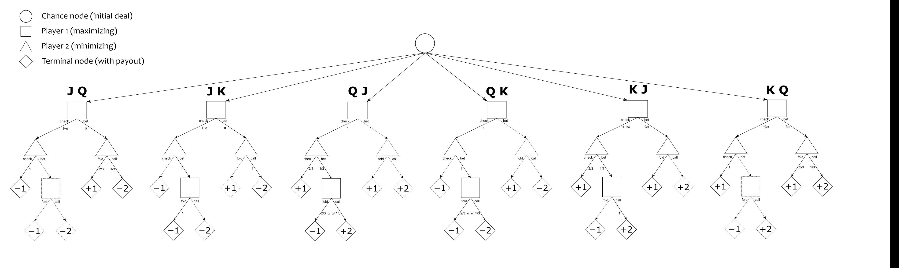

# Counterfactual Regret Minimization for Poker

Personal implementation of [Counterfactual Regret Minimization](https://poker.cs.ualberta.ca/publications/NIPS07-cfr.pdf) (CFR) in Python to approximate Nash equilibrium strategies in imperfect-information games.

This project implements Vanilla CFR. Each iteration traverses the full Kuhn Poker game tree, evaluating every action against the current strategy. At each information set, counterfactual regrets measure how much better each action would have been than the current strategy, weighted by the opponent's and chance reach probabilities. The strategy is then updated through regret matching, assigning probabilities proportional to positive cumulative regrets. 

A very good paper to get a good overview over CFR is the following: [An Introduction to Counterfactual Regret Minimization](https://modelai.gettysburg.edu/2019/deepstack/Resources/All/ICRM.pdf?utm_source=chatgpt.com)

The algorithm is tested on Kuhn Poker, a simplified version of poker. The game has only 12 information sets, making it a convenient test case for Vanilla CFR. Below is a graphical representation of the game in extensive form.



In two-player zero-sum games, the average strategies approach a Nash equilibrium. After 10,000 iterations, the implementation produces the following output:

```text
Results of Vanilla CFR on Kuhn Poker after 10000 iterations

Average utility of Player 0: -0.0555
Value of alpha: 0.2078

  J: Bet (Call)   0.2078 | Check (Fold) 0.7922
  Q: Bet (Call)   0.0003 | Check (Fold) 0.9997
  K: Bet (Call)   0.6126 | Check (Fold) 0.3874
Jcb: Bet (Call)      0.0 | Check (Fold) 1.0
Qcb: Bet (Call)   0.5508 | Check (Fold) 0.4492
Kcb: Bet (Call)   0.9999 | Check (Fold) 0.0001

 Jc: Bet (Call)   0.3345 | Check (Fold) 0.6655
 Qc: Bet (Call)   0.0004 | Check (Fold) 0.9996
 Kc: Bet (Call)      1.0 | Check (Fold) 0.0001
 Jb: Bet (Call)   0.0001 | Check (Fold) 1.0
 Qb: Bet (Call)   0.3393 | Check (Fold) 0.6607
 Kb: Bet (Call)      1.0 | Check (Fold) 0.0001
```